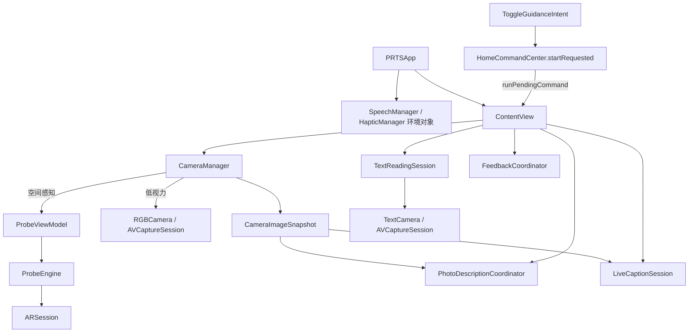

# 工程架构

本文说明 PRTS 的代码分层、应用装配关系、避障数据流、生命周期交接以及修改代码时需要遵守的工程约束。

PRTS 由主应用和两个本地 Swift Package 组成。核心避障算法位于 `Packages/SpatialCore`，不依赖 ARKit、UIKit 或 SwiftUI，支持在 macOS 上直接测试与回放；应用层负责相机采集、Metal 渲染、语音播报和触觉反馈。

## 目录结构

| 路径 | 职责 | 入口类型 |
|---|---|---|
| `PRTS/App/` | 应用入口、Shortcuts 快捷指令与全局命令转发 | `PRTSApp`、`ToggleGuidanceIntent`、`HomeCommandCenter` |
| `PRTS/Features/Home/` | 首页视图；协调各功能生命周期与 10 Hz 轮询 | `ContentView` |
| `PRTS/Features/Guidance/` | 相机意图控制（`Capture/`）、预览视图（`Views/`）、语音振动反馈（`Feedback/`）与空间适配（`Integration/`） | `CameraManager`、`RGBCamera`、`FeedbackCoordinator`、`SpeechManager`、`PathHaptics` |
| `PRTS/Spatial/` | ARKit 会话、帧快照、渲染器与诊断录制适配 | `ProbeEngine`、`ProbeViewModel`、`ProbeRenderer`、`ProbeOverlayGeometry` |
| `PRTS/Features/PhotoDescription/` | 短按画面描述与按住语音提问的协调、路由与提示词 | `PhotoDescriptionCoordinator` |
| `PRTS/Features/LiveCaption/` | 流式字幕采样调度、多击仲裁策略与千问视频请求 | `LiveCaptionSession` |
| `PRTS/Features/TextReading/` | 独占主摄拍照、多后端文字识别与逐句朗读 | `TextReadingSession` |
| `PRTS/Features/Settings/` | 设置页、智能服务配置与使用说明解析朗读 | `SettingsView`、`IntelligenceSettingsView`、`UserGuide`、`UserGuideDocument` |
| `PRTS/Features/Developer/` | Dev 录制包的系统分享界面 | `RecordingShareSheet` |
| `PRTS/Shared/Intelligence/` | 联网流式协议、HTTPS 安全检查、钥匙串凭证与本机模型路径 | `PhotoChatService`、`IntelligenceFeature` |
| `PRTS/Shared/Imaging/` | 相机预览、图像转正、缩放与 JPEG 编码 | `CaptureSessionPreview`、`PhotoImageEncoder` |
| `PRTS/Shared/Audio/` | 音频会话租约管理、TTS 输出、提示音与系统语音识别 | `AudioSessionCoordinator`、`AnswerAudioOutput`、`PhotoSpeechRecognizer` |
| `PRTS/Shared/Input/` | 按键状态判定、硬件按键接入与交互偏好 | `PhotoPressState`、`PhotoHardwareButtons`、`InteractionPreferences` |
| `PRTS/Shared/Diagnostics/` | 运行期应用错误日志 | `ErrorLog`、`ErrorReporter` |
| `PRTS/Shared/Recording/` | Dev 自动录制、交互录制上下文、原图音频附件、视频分段与 ZIP 打包 | `RecordingStore`、`DevInteractionRecording`、`RecordingVideoWriter`、`RecordingArchive` |
| `Packages/SpatialCore/` | 地面与障碍分析（`Perception/`）、路线规划（`Routing/`）、播报与触觉策略（`Feedback/`） | `SpatialAnalyzer`、`PathPredictor` |
| `Packages/LocalVLM/` | llama.cpp 封装，在设备上运行 MiniCPM-V | `LocalVLM` |
| `Vendor/PRTSCore/` | 上游契约源码快照；主应用不链接此包，仅运行契约测试 | — |
| `Experiments/` | 实验脚本、评测工具及冻结对照工程 `SpatialProbe/` | — |

`PRTS/Spatial/` 中以 `Probe` 开头的类型为应用实际运行实现；`Experiments/SpatialProbe/` 中的同名类型为冻结基线，仅用于一致性比对与回归验证。

## 应用装配



`ContentView` 持有各功能协调器，并集中管理交互权与反馈门控。进入设置、暂时失焦或切换前后台时，应用保留相机和计算运行意图，仅静音语音和振动，避免频繁重启 ARKit 会话。若系统在后台挂起或中断会话，回到前台后仅使用当前有效新结果。只有**读文字**需要独占后置主摄，开始前暂停当前采集并在结束后归还控制权。

低视力模式下，应用切换至 `RGBCamera` 保留普通相机预览、拍照描述和字幕，同时暂停 ARKit、LiDAR 和空间算法。`CameraImageSnapshot` 屏蔽底层图像源差异，使拍照与字幕功能无需区分当前采集后端。

## 避障数据流

每一帧进入分析队列后按以下管线流转：

```text
ARSession
  → ProbeEngine：生成 FrameSnapshot
  → SpatialAnalyzer：输出地面、障碍、未知三态栅格
  → PathPredictor
      → TemporalOccupancyGrid：确认持续 300 ms 以上的障碍
      → ObstacleWaypointPlanner：选定目标点并搜索绕行路线
  → RoutePublicationPolicy：裁决发布的路线状态
  → SharedStore
```

`FrameSnapshot` 持有同一帧的 `ARFrame`、时间戳、`epoch`、`frameID`、相机位姿和内参。LiDAR 设备读取 `sceneDepth` 与置信度；无 LiDAR 设备由单目深度模型估算。规划器仅将已确认障碍视作阻挡，未知单元格仍可参与路径搜索；在地面或深度短暂缺失时，系统沿用短时缓存路线以维持播报连续性。

### 线程与运行调度

采集、分析、反馈和渲染各自独立调度，通过 `SharedStore` 传递快照：

| 运行位置 | 触发条件 | 工作内容 |
|---|---|---|
| `probe.session` 队列 | ARKit 帧回调 | 构造 `FrameSnapshot` 投递至 `LatestMailbox`；会话启停请求也在此按序执行 |
| `probe.analysis` 队列 | 信箱收到新帧 | `drainAnalysis` 运行分析与规划，将候选结果写入录制数据，仅把通过时效检查的结果发布至 `SharedStore` |
| `probe.mesh` 队列 | ARKit 网格锚点更新 | 经 `MeshInbox` 合并后写入 `SharedStore.meshes`，供分析作为结构先验 |
| 主线程（每 0.1 s） | `ContentView` 定时器 | 读取快照驱动 `PathHaptics` 振动并每 1 s 写一次录制心跳；随后由 `FeedbackCoordinator` 触发播报 |
| 主线程（30 fps） | `MTKView` 绘制回调 | `ProbeRenderer` 读取 `SharedStore` 渲染界面与调试图层 |

`LatestMailbox` 仅保留最新一帧，未及处理的旧帧会被丢弃并在 Dev 录制中计数。每次主线程轮询统一评估静音门控条件：拍照、读文字、设置页、按住停止、低视力模式、使用说明、非活跃状态或音频中断之一成立时，语音和振动同时暂停；流式字幕仅暂停避障语音，方向振动继续输出。

## 路线状态与更新规则

当前测到可用地面时，系统根据前方最近已确认障碍的距离划分三种路线状态。没有当前地面时，不进入新的路线状态；独立的[整幅近障提示](spatial.md#无地面时的近障提示)不会创建路线。

| 状态 | 路线行为 | 语音播报 |
|---|---|---|
| 前方无已确认障碍 | 不绘制路线 | 进入该状态时播报“前方畅通” |
| 障碍距离 > 2 m | 在障碍前 0.55 m 处设定接近目标 | “有障碍” |
| 障碍距离 ≤ 2 m | 启动逐点绕行路径规划 | 播报距离等级与转向；< 1 m 时播报“障碍很近” |

状态切换设有迟滞以抑制边界抖动：进入近距离状态后，需障碍退至 2.15 m 以外并持续 0.75 s 才返回远距离状态；切回无障碍状态需持续 0.6 s。

### 目标点切换与障碍足迹

同一时刻仅存在一个当前目标点用于渲染、语音和振动：

1. 与当前目标点距离小于 1.2 m 时，每 0.25 s 预计算下一段衔接路线。
2. 距离小于 0.35 m 时复核下一段路线，复核通过则整体切换，否则重新搜索。
3. 目标点移出画面边缘 4% 以内时保留；超出 4%–25% 且持续 0.35 s 后重选；超出 25% 或位于身后时立即重选。

绕行规划优先保证两侧各留出 8 cm 余量；受限时使用 0.50 m 的最低规划通道宽度。

> [!NOTE]
> 当前代码中的身体宽度参数为 `0.60 m`，最低规划通道宽度为 `0.50 m`，二者参数尚待统一。相关回放统计请参阅[验证结果](validation.md)。

已确认障碍以世界坐标中的完整栅格方块保存（`OccupancyFootprint`），搜索、扫掠与复核共用同一障碍集（含当前窗口外的历史方块），防止视角旋转或裁切丢失障碍面积。跟踪丢失、`epoch` 递增或参数版本变化时，旧结果立即作废，延迟返回的异步结果将被丢弃。参数定义位于 `ObstacleWaypointState.swift` 和 `PathOptions.swift`。

## 播报频率控制

`ObstacleRouteAnnouncementPolicy` 按以下阈值抑制重复提示：

| 策略项 | 设定值 |
|---|---|
| 两次播报最短间隔 | 2.5 s |
| 场景变化防抖确认时间 | 0.6 s |
| 远近等级变化的最短重播间隔 | 4 s |
| 同侧目标点变更 | 不重复播报 |

无法绕行时播报“有障碍，无法绕行”（障碍小于 1 m 时为“障碍很近，无法绕行”）；画面内无可选目标点时改为“转动手机”。没有可用 LiDAR 分析结果时停止路线播报，由 `GuidanceAlertPolicy` 负责“暂时看不清”提示。

启动时不播报“初始化中”。首个畅通提示需要 0.5 s 的连续新测量，已经确认的障碍提示不受此等待限制。其他功能交还反馈后不补播静音期间的结果，详见[避障状态提示](usage.md#避障状态提示)。

## 相机交接

`ProbeEngine`（`ARSession`）、`RGBCamera` 和 `TextCamera` 三个采集后端严格互斥。`CameraManager` 持有用户的运行意图，并按以下规则交接：

| 事件 | 处理逻辑 | 负责类型 |
|---|---|---|
| 轻点开始 | 记录运行意图，校验相机权限后启动采集会话 | `CameraManager` |
| 停止避障 | 清除运行意图，取消未完成权限请求，立即暂停反馈 | `CameraManager` |
| 开始读文字 | 终止字幕和描述；通过 `pauseForTextReading(completion:)` 暂停会话但保留运行意图，会话停止后再打开主摄 | `ContentView`、`CameraManager` |
| 读文字退出 | 停止主摄后调用 `finishTextReading(isActive:)` 解除占用；在前台时立即恢复已启动的避障，在后台时待回到前台恢复 | `TextReadingSession`、`CameraManager` |
| 打开设置 / 失焦 | 保持相机与计算，仅关闭语音振动；未完成启动的请求不得在非活跃状态抢占相机 | `ContentView`、`CameraManager` |
| 进入后台 | 不主动停止空间会话；封存录制片段，由系统接管后台中断限制 | `ProbeViewModel`、`RecordingStore` |
| 系统音频中断 | 停止反馈；正在提问录音时释放麦克风并完成已有输入处理，不取消已发出的图像推理 | `ContentView`、`PhotoDescriptionCoordinator` |
| ARKit 系统中断 | 不主动暂停或重置会话；清空旧证据并推进 `epoch`，待系统恢复及有效跟踪帧到达 | `ProbeEngine` |
| RGB 媒体服务重置 | 仅在用户仍要求运行、应用活跃且中断结束时尝试重建一次 | `RGBCamera`、`RGBCameraRecovery` |
| 切换低视力模式 | 先停 ARKit 并清空空间输入，再启普通 RGB；关闭时按相反顺序切回 | `CameraManager` |

用户显式停止避障后，任何迟到的权限回调或读文字结束回调均不得重新拉起相机。低视力与读文字共用 `CaptureSessionPreview` 显示已有会话，视图存续期间不更换会话或旋转策略，也不负责相机启停。低视力预览跟随界面方向，读文字预览固定竖屏。

开启“点按停止”或检测到辅助触控、切换控制时，主按钮切为轻点停止。由于 `UIAccessibility.isAssistiveTouchRunning` 仅在开启引导式访问时能可靠返回 true，普通辅助触控用户需在设置中手动打开“点按停止”。

## 拍照按键分发链路

屏幕拍照按钮与实体按键事件均先经过流式字幕的连按仲裁，再路由到目标功能：

```text
ContentView.photoDown
  → LiveCaptionSession.down → LiveCaptionPressState
      ├─ .photo：交给 PhotoDescriptionCoordinator.perform（短按描述 / 按住提问）
      ├─ .start：连按三下时中止描述并启动流式字幕
      └─ .stop：字幕运行中按一下退出
```

按键时间阈值见[交互与设置规格](usage.md)。

## 设计约束

修改代码时必须遵守以下边界，对应检查脚本位于 `scripts/`，单元测试位于 `PRTSTests/`：

| 约束规则 | 检查位置 |
|---|---|
| 仅 `ProbeEngine` 允许实例化 `ARSession` | `scripts/test_repository_layout.py` |
| `Shared/` 不得引用 `Features/`、`Spatial/` 或 `App/`；`Spatial/` 不得引用 `Features/` 或 `App/` | `scripts/test_repository_layout.py` |
| `SpatialCore` 不得导入 ARKit、UIKit、SwiftUI、AVFoundation、Metal 或 Core ML | `scripts/test_repository_layout.py` |
| `SpatialAnalyzer` 需与 `Experiments/SpatialProbe/` 的冻结实现保持核心逻辑一致 | `scripts/test_spatial_integration.py` |
| 渲染器仅消费 `SharedSnapshot`，隐藏画面不影响分析；停止渲染应使用无画面模式 | `scripts/test_spatial_integration.py` |
| 所有异步任务必须核对取消标志和代次；迟到结果不得更新界面、补播旧回答或重启已停止功能 | `TextReadingSessionTests`、`LiveCaptionSessionTests`、`scripts/test_stability_boundaries.py` |
| 相机启停、迟到权限回调与读文字交接不得出现抢占或死锁 | `PRTSTests/App/CameraRecoveryTests.swift` |

### 音频会话调度

应用内所有提示音、TTS 与录音统一通过 `AudioSessionCoordinator` 申请租约，只有持有最新租约的一方能关闭会话。重操作均已移出主线程：

| 操作 | 执行线程与策略 |
|---|---|
| 关闭音频会话 | 独立串行队列，延迟 0.25 s 执行；期间若有新激活请求则自动取消关闭 |
| 提示音与启动录音 | 通过 `activateAsync` 在独立队列激活；激活完成后复核是否已松手或取消 |
| 语音朗读 | 在同一队列激活并由主线程短时同步等待（通常约 15 ms，若关闭操作正在执行则等其完成） |

Dev 构建的录制采集与打包导出均运行在独立队列，详见[开发指南](development.md#自动录制)。

## 第三方代码

`Vendor/PRTSCore/` 同步自 [Oldcucumber/PRTS_Core](https://github.com/Oldcucumber/PRTS_Core)，锁定提交 `0469479b`（2026-09-24 核对）。主应用不链接该包，仅运行契约测试。如需升级快照，请按以下步骤操作：

1. 将 `scripts/sync-prts-core.sh` 中的 `revision` 更新为目标提交的完整哈希。
2. 运行 `bash scripts/sync-prts-core.sh` 同步契约、测试和提示音资源。
3. 运行 `PRTS_CONTRACTS_ONLY=1 swift test --package-path Vendor/PRTSCore` 确认契约测试通过。
4. 更新本节记录的提交哈希和核对日期。

llama.cpp 与 MiniCPM-V 权重由 `Packages/LocalVLM/prepare.sh` 准备且不纳入仓库，配置见[图像与文字识别](vision.md#本地视觉模型)。

## 相关文档

- [空间感知](spatial.md)：坐标投影、地面确认、占用栅格与无 LiDAR 校准
- [图像与文字识别](vision.md)：服务路由、提示词、流式字幕、文字识别与本地 VLM
- [开发指南](development.md)：编译、测试、CI、Dev 自动录制与数据工具
