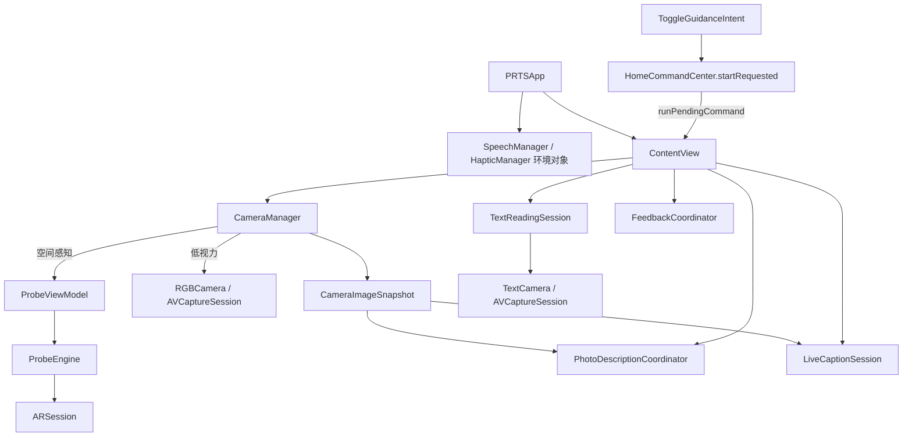

# 工程架构

PRTS 由主应用和一个负责核心空间算法的独立 Swift Package（`Packages/SpatialCore`）及本地推理包（`Packages/LocalVLM`）组成。`SpatialCore` 不依赖 ARKit、UIKit 或 SwiftUI，可以在 macOS 上直接运行单元测试和离线回放；应用层则承担传感器采集、相机生命周期、画面渲染和语音触觉输出。

## 目录结构

| 路径 | 职责 | 核心入口 |
|---|---|---|
| `PRTS/App/` | 应用入口、Shortcuts 快捷指令与启动命令中心 | `PRTSApp`、`ToggleGuidanceIntent`、`HomeCommandCenter` |
| `PRTS/Features/Home/` | 首页视图与总协调器，管理各功能生命周期与 10 Hz 轮询 | `ContentView` |
| `PRTS/Features/Guidance/` | 相机运行意图管理（`Capture/`）、预览控件（`Views/`）、语音振动反馈（`Feedback/`）与空间适配（`Integration/`） | `CameraManager`、`RGBCamera`、`FeedbackCoordinator`、`SpeechManager`、`PathHaptics` |
| `PRTS/Spatial/` | ARKit 会话管理、帧打包、Metal 渲染与诊断采集适配 | `ProbeEngine`、`ProbeViewModel`、`ProbeRenderer`、`ProbeOverlayGeometry` |
| `PRTS/Features/PhotoDescription/` | 短按画面描述与按住语音提问的协调器、后端路由与提示词 | `PhotoDescriptionCoordinator` |
| `PRTS/Features/LiveCaption/` | 实时流式字幕采样调度、多击仲裁策略与千问视频请求 | `LiveCaptionSession` |
| `PRTS/Features/TextReading/` | 独占主摄拍照、多后端文字识别与逐句朗读 | `TextReadingSession` |
| `PRTS/Features/Settings/` | 设置页、智能服务配置与使用说明解析朗读 | `SettingsView`、`IntelligenceSettingsView`、`UserGuide`、`UserGuideDocument` |
| `PRTS/Features/Developer/` | Dev 构建录制包的系统分享面板 | `RecordingShareSheet` |
| `PRTS/Shared/Intelligence/` | 联网流式解析、HTTPS 校验、钥匙串凭证与本地模型加载封装 | `PhotoChatService`、`IntelligenceFeature` |
| `PRTS/Shared/Imaging/` | 图像转正、按最长边缩放与 JPEG 编码 | `PhotoImageEncoder` |
| `PRTS/Shared/Audio/` | 音频会话租约协调、TTS 播报、提示音与系统语音识别 | `AudioSessionCoordinator`、`AnswerAudioOutput`、`PhotoSpeechRecognizer` |
| `PRTS/Shared/Input/` | 按键状态机、硬件按键监听与交互偏好 | `PhotoPressState`、`PhotoHardwareButtons`、`InteractionPreferences` |
| `PRTS/Shared/Diagnostics/` | 运行期应用错误日志 | `ErrorLog`、`ErrorReporter` |
| `PRTS/Shared/Recording/` | Dev 构建自动录制、视频分段写入与 ZIP 归档 | `RecordingStore`、`DevInteractionRecording`、`RecordingVideoWriter`、`RecordingArchive` |
| `Packages/SpatialCore/` | 地面拟合与障碍占用（`Perception/`）、路线规划（`Routing/`）、播报与触觉策略（`Feedback/`） | `SpatialAnalyzer`、`PathPredictor` |
| `Packages/LocalVLM/` | llama.cpp C++ 封装，离线运行 MiniCPM-V | `LocalVLM` |
| `Vendor/PRTSCore/` | 上游契约源码快照；主应用不链接该包，仅在测试中核对契约一致性 | — |
| `Experiments/` | 离线评估、标注与回放工具，以及冻结的对照工程 `SpatialProbe/` | — |

`PRTS/Spatial/` 下以 `Probe` 开头的类型是主应用实际运行的代码；`Experiments/SpatialProbe/` 中同名的实现仅作为冻结基线用于一致性和回归对照。

## 应用装配与协调关系



`ContentView` 持有相机与各项智能功能的协调实例，并根据当前视图、焦点、音频状态统一门控反馈。打开设置、临时失焦或切换前后台时，应用保留相机和计算意图，仅暂停语音和触觉反馈，避免频繁重建 ARKit 会话。真正退入后台后若系统挂起或中断会话，回到前台只接收当前有效的新结果。只有**读文字**因需要高清晰度照片而独占后置主摄，开始前暂停当前采集，结束后归还运行权。

低视力模式下，系统切换到 `RGBCamera` 维持预览、描述和字幕，同时停用 ARKit、LiDAR 和空间算法。`CameraImageSnapshot` 屏蔽了底层相机差异，让拍照描述和流式字幕以同一套代码读取最新图像。

## 避障数据流

每一帧进入分析队列后依次流过以下模块：

```text
ARSession
  → ProbeEngine：生成 FrameSnapshot
  → SpatialAnalyzer：输出地面、障碍、未知三态栅格
  → PathPredictor
      → TemporalOccupancyGrid：确认持续 300 ms 以上的障碍
      → ObstacleWaypointPlanner：选定目标点并搜索绕行路线
  → RoutePublicationPolicy：裁决当前可发布的路线状态
  → SharedStore
```

`FrameSnapshot` 绑定同一帧的 `ARFrame`、时间戳、`epoch`、`frameID`、相机位姿及内参。LiDAR 机型直接读取系统 `sceneDepth` 与置信度，无 LiDAR 机型则由单目模型估算深度。规划器仅将已确认的障碍视作阻挡，未知单元格仍允许作为候选路径，因此在地面或深度短暂中断时会沿用短时缓存路线，而不是立刻判为危险或撤销。

### 线程模型与调度

采集、算法、反馈和渲染各自独立运行，通过 `SharedStore` 交换最新快照：

| 执行位置 | 触发源 | 主要工作 |
|---|---|---|
| `probe.session` 串行队列 | ARKit 帧回调 | 打包 `FrameSnapshot` 投递到 `LatestMailbox`；会话启停请求也在此按序执行 |
| `probe.analysis` 队列 | 信箱收到新帧 | `drainAnalysis` 执行感知与规划，将候选结果写入录制数据，通过时效检查的结果更新至 `SharedStore` |
| `probe.mesh` 队列 | ARKit 网格更新 | 经 `MeshInbox` 合并后写入 `SharedStore.meshes`，供分析时作为结构先验 |
| 主线程（每 0.1 s） | `ContentView` 定时器 | 读取快照驱动 `PathHaptics` 振动与每秒一次的录制心跳，交由 `FeedbackCoordinator` 触发播报 |
| 主线程（30 fps） | `MTKView` 绘制回调 | `ProbeRenderer` 读取 `SharedStore` 渲染相机画面与调试图层 |

`LatestMailbox` 只保留最新一帧，分析来不及消化的旧帧直接丢弃并在 Dev 录制中计数。每次主线程轮询统一计算反馈静默条件：只要处于拍照提问、读文字、打开设置、按住停止、低视力模式、显示使用说明、非活跃状态或系统音频中断之一，语音和振动同时暂停；流式字幕运行期间仅暂停避障语音，方向振动继续工作。

## 路线状态与更新规则

系统按前方最近已确认障碍的距离划分三种路线状态：

| 状态 | 路线动作 | 语音播报 |
|---|---|---|
| 前方无已确认障碍 | 清除当前路线 | 刚进入该状态时播报“前方畅通” |
| 障碍距离 > 2 m | 在障碍前 0.55 m 处设立接近目标 | “有障碍” |
| 障碍距离 ≤ 2 m | 启动逐点绕行路径规划 | 播报距离等级与转向；< 1 m 时提示“障碍很近” |

为了防止临界距离反复跳变，状态切回设有迟滞：进入近距离状态后，需障碍退至 2.15 m 外且持续 0.75 s 才退回远距离状态；切回无障碍状态需持续 0.6 s。

### 目标点切换与障碍足迹

画面同一时刻仅维护一个引导目标点：

1. 距当前目标小于 1.2 m 时，每 0.25 s 预计算下一段衔接路线。
2. 距当前目标小于 0.35 m 时复核下一段路线，通过则整体切换，否则重搜。
3. 目标移出屏幕边缘 4% 以内时保持不变；超出 4%–25% 且持续 0.35 s 后重选；超出 25% 或落到身后时立即重选。

绕行时优先保证身体两侧各有 8 cm 余量；狭窄环境下最低按 0.50 m 规划通道宽度搜索。注意：当前产品代码里身体宽度参数为 `0.60 m`，而最低规划通道宽为 `0.50 m`，这一参数差异尚待统一（参见[验证结果](validation.md)）。

所有已确认障碍以世界坐标下的完整栅格方块保存（`OccupancyFootprint`），搜索、扫掠和复核共用同一障碍集（包含当前窗口外的历史块），避免屏幕旋转或裁切丢掉周边障碍。一旦发生跟踪丢失、`epoch` 递增或参数版本变化，所有旧结果立刻失效，晚到的异步任务结果会被抛弃。具体参数定义在 `ObstacleWaypointState.swift` 和 `PathOptions.swift`。

## 播报频率控制

`ObstacleRouteAnnouncementPolicy` 控制播报节奏，避免提示音互相打断或刷屏：

| 策略项 | 设定值 |
|---|---|
| 两次播报最短间隔 | 2.5 s |
| 场景切换防抖确认时间 | 0.6 s |
| 远近等级变化的最短重播间隔 | 4 s |
| 同侧目标微调 | 不重复播报 |

无路可绕时播报“有障碍，无法绕行”（1 m 内为“障碍很近，无法绕行”）；若画面中完全找不到可见目标点，改为“转动手机”。没有可用的 LiDAR 分析结果时停止路线播报，改由 `GuidanceAlertPolicy` 负责“暂时看不清”提示。

点击开始后的首句固定播报“初始化中”，0.5 s 后立即播报第一条有效状态（该 0.5 s 等待不消耗 2.5 s 冷却间隔）；其余从设置或智能问答恢复避障的场景静默等待 0.5 s 后直接继续播报。

## 相机交接与生命周期

三个图像消费者（`ProbeEngine` 的 `ARSession`、`RGBCamera` 的普通采集以及 `TextCamera` 的主摄拍照）严格互斥。`CameraManager` 持有用户的“期望运行状态（运行意图）”，按以下规则完成交接：

| 触发事件 | 处理策略 | 负责模块 |
|---|---|---|
| 点击开始 | 记录运行意图，校验相机权限后启动对应采集会话 | `CameraManager` |
| 停止避障 | 清除运行意图，取消未完成的权限回调，立即关闭反馈 | `CameraManager` |
| 开始读文字 | 终止描述和字幕，通过 `pauseForTextReading(completion:)` 释放会话但保留运行意图，待旧会话停止后才开启主摄 | `ContentView`、`CameraManager` |
| 读文字退出 | 停止主摄并调用 `finishTextReading(isActive:)` 归还相机；处于前台则立即恢复避障，在后台则等回到前台再恢复 | `TextReadingSession`、`CameraManager` |
| 打开设置 / 失焦 | 保持相机和空间计算运行，只关闭语音振动；防止未授权请求在非活跃状态抢占相机 | `ContentView`、`CameraManager` |
| 进入后台 | 不主动销毁空间会话，封存当前录制片段，接受系统挂起与相机中断 | `ProbeViewModel`、`RecordingStore` |
| 系统音频中断 | 停止播报；若正在录音提问则释放麦克风并完成已收集内容的处理，不中断已发出的视觉推理 | `ContentView`、`PhotoDescriptionCoordinator` |
| ARKit 系统中断 | 不手动调用 pause 或重置会话，清空旧证据并推进 `epoch`，待系统回调恢复后用新帧重建 | `ProbeEngine` |
| RGB 媒体服务重置 | 仅在仍有运行意图、应用在前台且中断结束时尝试重建一次 | `RGBCamera`、`RGBCameraRecovery` |
| 切换低视力模式 | 先停 ARKit 并清空空间输入，再开普通 RGB；关闭时按相反顺序切回 | `CameraManager` |

无论发生哪种中断，一旦用户明确停止过避障，任何迟到的权限结果或读文字结束回调都不得重新拉起相机。

开启“点按停止”或检测到系统辅助触控、切换控制启用时，主按钮直接切换为点按停止。由于系统的 `UIAccessibility.isAssistiveTouchRunning` 仅在开启引导式访问时能可靠返回 true，普通辅助触控用户仍需在设置中手动打开“点按停止”。

## 拍照按键分发链路

屏幕拍照按钮与实体按键事件先进入流式字幕的连按仲裁，再下发给拍照描述或字幕开关：

```text
ContentView.photoDown
  → LiveCaptionSession.down → LiveCaptionPressState
      ├─ .photo：交给 PhotoDescriptionCoordinator.perform（短按描述 / 按住提问）
      ├─ .start：连按三下时中止描述并启动流式字幕
      └─ .stop：字幕运行中单按退出
```

## 设计约束

以下架构红线大多已写入 `scripts/` 自动化测试与 `PRTSTests/` 单元测试，改动代码时必须遵守：

| 约束规则 | 验证位置 |
|---|---|
| 全应用仅 `ProbeEngine` 允许实例化 `ARSession` | `scripts/test_repository_layout.py` |
| `Shared/` 不得反向引用 `Features/`、`Spatial/` 或 `App/`；`Spatial/` 不得引用 `Features/` 或 `App/` | `scripts/test_repository_layout.py` |
| `SpatialCore` 禁止导入 ARKit、UIKit、SwiftUI、AVFoundation、Metal 或 Core ML | `scripts/test_repository_layout.py` |
| `SpatialAnalyzer` 需与 `Experiments/SpatialProbe/` 的冻结实现保持核心逻辑等价 | `scripts/test_spatial_integration.py` |
| 渲染器仅消费 `SharedSnapshot`，隐藏画面不得影响后台分析；关闭渲染应走无画面模式 | `scripts/test_spatial_integration.py` |
| 所有异步交互必须核对取消标志和代次；迟到结果不得在停止或失焦后更新界面或补播旧语音 | `TextReadingSessionTests`、`LiveCaptionSessionTests`、`scripts/test_stability_boundaries.py` |
| 相机启停、迟到授权与读文字交接不得出现抢占或死锁 | `PRTSTests/App/CameraRecoveryTests.swift` |

### 音频会话调度

应用内所有提示音、TTS 和录音统一向 `AudioSessionCoordinator` 申请租约，每次激活返回最新租约凭证，旧朗读结束释放时不会误关新任务的会话。主线程负责相机和 10 Hz 轮询，重操作均已移出主线程：

| 音频操作 | 所在线程与策略 |
|---|---|
| 停用音频会话 | 独立串行队列，延迟 0.25 s 执行；期间若有新激活请求则自动取消停用 |
| 提示音与启动录音 | 通过 `activateAsync` 在后台队列激活，等待麦克风就绪后再检查用户是否已松手或取消 |
| 语音朗读 | 在同一串行队列激活并在主线程短时同步等待（通常约 15 ms，若刚触发延迟关闭则等其结束） |

Dev 模式的录制采集与导出打包同样在独立队列隔离执行，详见[开发指南](development.md#自动录制)。

## 第三方源码与依赖

`Vendor/PRTSCore/` 同步自上游仓库 [Oldcucumber/PRTS_Core](https://github.com/Oldcucumber/PRTS_Core)，当前锁定提交 `0469479b`（2026-09-24 核对）。主应用不直接链接它，只运行其中的契约测试。更新上游快照的步骤如下：

1. 在 `scripts/sync-prts-core.sh` 中更新 `revision` 为目标提交的完整哈希。
2. 运行 `bash scripts/sync-prts-core.sh` 同步契约、测试与提示音资源。
3. 运行 `PRTS_CONTRACTS_ONLY=1 swift test --package-path Vendor/PRTSCore` 确认契约测试全部通过。
4. 更新本节记录的提交哈希和核对日期。

llama.cpp 与 MiniCPM-V 权重由 `Packages/LocalVLM/prepare.sh` 负责拉取与编译，配置细节见[图像与文字识别](vision.md#本地视觉模型)。

## 延伸阅读

- [空间感知](spatial.md)：投影数学、地面确认、通行检查与无 LiDAR 单目校准
- [图像与文字识别](vision.md)：提示词设计、动态抽帧、OCR 管线与本机 VLM 接口
- [开发指南](development.md)：编译、测试、CI、Dev 自动录制与回放脚本
