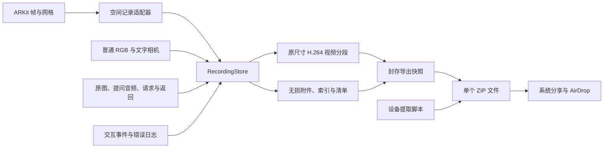

# 开发指南

这份指南覆盖本地编译环境准备、测试与持续集成流程、代码格式工具、Dev 调试录制以及离线回放与品牌导出工具。代码分层和约束见[工程架构](architecture.md)，规范见 [AGENTS.md](../AGENTS.md)。

## 环境准备

| 依赖项 | 最低要求 |
|---|---|
| Xcode 与系统 | macOS，Xcode 26+（使用 iOS 26 SDK API），部署目标 iOS 17+ |
| 本地推理构建 | `cmake`、`ninja`、可用网络、约 2 GB 可用磁盘 |
| 辅助脚本与格式化 | Python 3.11+ |
| 真机安装 | 已配置 Apple 开发者签名团队 |

## 构建

1. 准备本地视觉模型和 `PRTSLocalVLM.xcframework`（只需在首次克隆或改动 `Packages/LocalVLM/csrc/` 后运行）：

   ```sh
   bash Packages/LocalVLM/prepare.sh
   ```

   脚本默认使用 `-j 2` 编译以照顾 8 GB 内存 Mac；可通过环境变量 `JOBS` 调整并发数。

2. 编译标准版或开发版（使用隔离的 `DerivedData` 目录避免产物混用）：

   ```sh
   # Release 标准版
   xcodebuild -project PRTS.xcodeproj -scheme PRTS -configuration Release      -destination 'generic/platform=iOS' -derivedDataPath build/Standard build

   # Dev 开发版
   xcodebuild -project PRTS.xcodeproj -scheme PRTS -configuration Dev      -destination 'generic/platform=iOS' -derivedDataPath build/Dev build
   ```

如需将当前 Git 提交哈希注入二进制，可附加参数 `PRTS_SOURCE_COMMIT=$(git rev-parse HEAD)`。

### 构建模式

工程仅保留 `Release` 与 `Dev` 两种配置。两者拥有完全相同的界面、算法和编译优化；`Dev` 额外定义了 `PRTS_DEV` 编译宏，用来启用自动调试录制并在设置底部露出分享/清除入口：

| 模式 | 运行期数据录制与界面差异 |
|---|---|
| `Release` | 仅记录应用错误日志，不写入任何相机、空间或语音问答数据 |
| `Dev` | 每次启动自动录制；首页顶部常驻隐私提示条；设置最下方提供打包分享与清空按钮 |

共享 `PRTS` scheme 在 Run / Test / Analyze 时默认采用 `Dev`，Archive / Profile 时默认采用 `Release`。

## 测试

### 完整校验脚本

在已执行过 `prepare.sh` 的 Mac 上运行：

```sh
bash scripts/validate_spatial.sh
```

脚本会串联运行 `SpatialCore`（Debug & Release）、`PRTSContracts` 契约测试、全套 Python 工程检查脚本，以及 arm64 模拟器（Dev）与真机（Release）的无签名编译。由于静态检查和模拟测试不能代替传感器与语音听感，涉及交互与推理的改动仍需在真机运行 `xcodebuild test` 或人工实测。

### 分项检查命令

```sh
swift test --package-path Packages/SpatialCore
PRTS_CONTRACTS_ONLY=1 swift test --package-path Vendor/PRTSCore
python3 -m unittest discover -s scripts -p 'test_*.py'
git diff --check
```

`SpatialCore` 的路线测试按场景拆分为独立测试类（共享场景构造器位于 `Tests/SpatialCoreTests/Support/RoutingTestScene.swift`），可用 `--filter` 单独执行，例如 `swift test --package-path Packages/SpatialCore --filter RouteProjectionTests`。

### 持续集成（GitHub Actions）

工作流 `.github/workflows/code-quality.yml` 在每次推送或 PR 指向 `main` 时触发三个任务：

| Job | 执行内容 |
|---|---|
| `style-and-boundaries` | 全仓库格式检查、Python 边界与契约测试、`git diff --check` |
| `spatial-tests` | `SpatialCore` 算法测试与 `Vendor/PRTSCore` 契约测试 |
| `app-build` | 编译 `Release` 与 `Dev`，运行模拟器 `PRTSTests`，并验证真机工程可编通 |

`app-build` 使用 `scripts/ci/local_vlm_stub.cpp` 编译可链接的 LocalVLM 空桩与占位权重文件（因此 CI 会跳过 `PhotoLocalModelTests`，也不验证相机、传感器和真实推理）；其余 `PRTSTests` 在两种构建配置下实际运行。另外，由于公开 UI 自动化框架无法模拟三指长按手势，依赖该手势的读文字 UI 测试项默认跳过并在真机手工核验，生命周期本身由单元测试覆盖。

### 代码格式化

项目锁定了格式工具版本，`scripts/style.py` 检测到版本不匹配时会直接报错：

| 语言 | 工具与固定版本 |
|---|---|
| Swift | `swift-format` 6.2.0（若 Xcode 自带版本不同，可通过 `SWIFT_FORMAT` 环境变量指定） |
| Python | Ruff 0.14.0 |
| C++ / Metal | clang-format 21.1.0 |
| Shell | shfmt 3.12.0 |

安装与检查命令：

```sh
python3 -m venv .venv
source .venv/bin/activate
python -m pip install -r scripts/requirements-style.txt
python scripts/install_shfmt.py

python scripts/style.py          # 检查全部纳入版本控制与未跟踪的自有源码
python scripts/style.py --fix    # 自动格式化并应用安全的 Python 修复
```

检查自动排除 `Vendor/PRTSCore/`、生成产物和原始评测数据。此外，Core ML 模型附带的 `Manifest.json` 与 `AppleModelCard.txt` 在 `.gitattributes` 中配置了保留原始字节（防止换行符转换），`test_spatial_integration.py` 会校验它们的字节长度与 SHA-256。

## 自动录制

`Dev` 构建每次启动都会在 `Documents/Recordings/<时间戳>-<UUID>/` 自动创建会话目录，传感器仍按功能需求触发，录制过程不会额外唤醒 ARKit 或麦克风。

| 数据项 | 存储方式 |
|---|---|
| RGB 视频 | H.264 编码，目标码率 1 Mbps；保持相机原始尺寸、方向和实际时间戳分段，不补帧也不裁切 |
| 深度、置信度与点云 | 原始尺寸及精度，无损 raw DEFLATE 压缩，附带原始长度、SHA-256、位姿与内参 |
| 网格与空间决策 | 完整网格锚点增删改、算法输入输出、参数版本及路径结果 |
| 拍照、提问与读文字 | 单独保存相机原图和实际编码送入模型的 JPEG，避免视频压缩糊掉文字 |
| 流式字幕 | 依赖原尺寸 RGB 视频以及实际挑出提交的 JPEG 帧、时间戳和帧索引 |
| 语音提问 | 仅在按住录音窗口保存麦克风音频与识别文本 |
| 交互与返回 | 以墙钟和单调时钟记录功能启停、取消、前后台、错误日志和模型返回 |

1 Mbps 仅约束 RGB 视频轨，其余无损附件另计，因此整体录制体积会高于 1 Mbps。所有记录均严格过滤认证头和 API Key。

> [!IMPORTANT]
> 自动录制会在本机保存现场图像、空间结构和提问声音，仅用于开发者手工导出分析，首页会持续展示“此构建将自动录制数据到本地，请注意隐私安全”。

### 录制结构与导出流程



写入与导出使用独立队列：分享导出会在安全点封存当前已落盘的片段并打包为 `PRTS-<时间戳>.zip`，期间正在运行的功能继续向新片段写入。执行清除操作会递增录制代次，确保清除前已发出的异步视觉或音频回调无法将旧数据写回新目录。强杀进程或空间不足导致尾段缺少结束标记时，读取工具会明确标出数据缺口而不作伪造补全。

除了在 Dev 版“设置”底部通过系统分享面板导出或清空外，也可以在电脑端直接从已配对设备拉取：

```sh
python3 scripts/pull_recordings.py --device <设备标识> --output <录制文件.zip>
```

## 数据工具

以下本地脚本均只处理离线数据，不联网上传：

| 用途 | 命令或脚本路径 |
|---|---|
| 从真机拉取录制包 | `python3 scripts/pull_recordings.py --device <设备标识> --output <录制文件.zip>` |
| 校验与解包录制 | `python3 scripts/read_recording.py --help` |
| 校验空间诊断记录 | `python3 scripts/read_diag.py <run> --verify-data` |
| 提取 LiDAR / 预测深度帧 | `python3 scripts/read_diag.py <run> --extract-depth\|--extract-prediction <epoch>:<frame> --output <目录>` |
| 路线对比回放 | `scripts/replay_routes.swift`、`scripts/compare_route_replays.py` |
| 规划快照回放 | `scripts/replay_route_snapshots.swift`（默认 `obstacle_veto_v1`，加 `--verified` 切换严格策略） |
| 完整避障链路重跑 | `bash Experiments/astra/run.sh <诊断目录>` |
| 源码行数盘点 | `python3 scripts/code_inventory.py`（加 `--write` 更新 `build/code-inventory.md`） |

`read_diag.py` 兼容早期旧格式的独立空间诊断文件；标注 `source=synthetic` 的输出为合成测试用例数据。

### 回放注意事项

- 比较不同版本的路线策略时，必须确保输入帧序列、`epoch`、`frameID` 与时间戳完全一致；回放仅能基于已录制传感器视角的输入重新计算，无法模拟走向另一条路线后传感器会拍到的新画面。
- `Experiments/astra/` 下分别维护了回放当前产品代码（`run_product.sh`）与复现第二轮历史原型实验（`run_round2.sh`）的入口，两者共享 `generated/` 目录但只编译各自的显式源文件清单；运行历史复现前需本地保留 `prepare.py` 指定的基准提交。所有以工具计算的离线统计均为代理指标，最终结论统一记在[验证结果](validation.md)。

### SpatialProbe 对照工程

`Experiments/SpatialProbe`（Bundle ID：`org.prts.SpatialProbe`）是冻结的感知对照 App，运行 `bash scripts/validate.sh` 或在 Xcode 打开 `PRTSSpatialProbe.xcodeproj` 即可验证。

## 品牌资源

`docs/branding/` 保存图标和字标的原始矢量文件（文字已转曲线，渲染使用 mask，请勿改动几何与色彩，导出需借助 WebKit 渲染）：

| 源文件 | 导出规范 |
|---|---|
| `app-logo-prts.svg` | 1024×1024 不透明 PNG，用于浅色、深色与着色版 App 图标 |
| `app-logo.svg` | 黑底白字，按 32 pt 导出 1×、2×、3× PNG 作为首页标志 |
