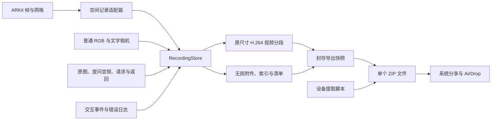

# 开发指南

本文说明 PRTS 的构建环境、编译模式、自动化测试、代码格式化、Dev 自动录制与离线数据工具。代码分层与约束请参阅[工程架构](architecture.md)，编码规范请参阅 [AGENTS.md](../AGENTS.md)。

## 环境要求

| 项目 | 要求 |
|---|---|
| 应用构建 | macOS、Xcode 26 或更高版本（使用 iOS 26 SDK API），部署目标 iOS 17 |
| 本地模型构建 | `cmake`、`ninja`、网络连接及约 2 GB 可用磁盘空间 |
| 工具脚本与格式检查 | Python 3.11 或更高版本 |
| 真机安装 | 已配置 Apple 开发者签名团队 |

## 构建

1. 准备本地视觉模型和推理库（首次构建或修改 `Packages/LocalVLM/csrc/` 后执行）：

   ```sh
   bash Packages/LocalVLM/prepare.sh
   ```

   脚本默认使用 `-j 2` 编译以适配 8 GB 内存 Mac；可通过环境变量 `JOBS` 调整并行任务数。

2. 构建标准版或开发版应用（两者使用独立的 DerivedData 目录以避免产物混用）：

   ```sh
   # 标准版（Release）
   xcodebuild -project PRTS.xcodeproj -scheme PRTS -configuration Release \
     -destination 'generic/platform=iOS' -derivedDataPath build/Standard build

   # 开发版（Dev）
   xcodebuild -project PRTS.xcodeproj -scheme PRTS -configuration Dev \
     -destination 'generic/platform=iOS' -derivedDataPath build/Dev build
   ```

如需将源码提交哈希写入二进制，请附加构建参数 `PRTS_SOURCE_COMMIT=$(git rev-parse HEAD)`。

### 本机签名

工程启用自动签名，不指定开发团队。要使用自己的 Apple 账号在真机上运行，请在 Xcode 中登录账号，然后在 `Config/Signing.local.xcconfig` 中设置 `DEVELOPMENT_TEAM` 为该账号的团队 ID。此文件仅供本机使用，不提交到仓库。

如果团队不能使用默认标识符 `com.jingxuan.PRTS`，可以在同一文件中设置 `PRTS_DEV_BUNDLE_ID` 为团队可用的唯一标识符。此设置只影响 Dev 应用及其测试目标，不会更改 Release 的标识符。使用个人团队进行开发签名时，需要在该团队下注册测试设备。

### 构建模式

工程仅提供 `Release` 与 `Dev` 两种构建配置。两者共享完全一致的界面、避障算法和编译优化；`Dev` 额外定义 `PRTS_DEV` 编译宏，用于启用自动录制并在设置末尾提供导出与清除操作：

| 模式 | 录制与界面行为 |
|---|---|
| `Release` | 仅记录应用错误日志，不保存相机、空间或语音问答数据 |
| `Dev` | 自动录制到本地；首页显示隐私提示；设置底部提供分享和清除录制按钮 |

共享 `PRTS` scheme 在 Run、Analyze 和 Test 时默认采用 `Dev`，在 Archive 和 Profile 时默认采用 `Release`。

## 测试

### 完整校验脚本

在已准备本地模型的 Mac 上运行：

```sh
bash scripts/validate_spatial.sh
```

脚本依次执行 `SpatialCore` 的 Debug/Release 测试、`PRTSContracts` 契约测试、全套 Python 工程检查脚本，以及 arm64 模拟器（Dev）和真机（Release）的无签名编译。由于静态检查和模拟器测试无法覆盖真机传感器与语音听感，涉及交互和推理的修改仍需在真机运行 `xcodebuild test` 或手工验收。

### 单项检查

```sh
swift test --package-path Packages/SpatialCore
PRTS_CONTRACTS_ONLY=1 swift test --package-path Vendor/PRTSCore
python3 -m unittest discover -s scripts -p 'test_*.py'
git diff --check
```

`SpatialCore` 的路线测试按场景拆分（共享场景构造器位于 `Tests/SpatialCoreTests/Support/RoutingTestScene.swift`），可通过 `--filter` 单独运行，例如 `swift test --package-path Packages/SpatialCore --filter RouteProjectionTests`。

### 持续集成

`Code quality` 对每个进入 `main` 的提交分别验证，批量推送时为中间提交补发独立运行。运行名称和摘要显示实际被测 SHA；新推送不取消旧运行。PR 验证合并结果。

| 检查模式 | 执行内容 |
|---|---|
| 全量 | 全仓格式与风格、Python 工具与工程边界、空间算法（Debug 和 Release）、SpatialProbe 实验包和上游契约、Release 和 Dev 的 App 单元测试、无签名真机编译及包内中英文权限说明 |
| 已有应用 Swift 源码修改 | 按完整文件检查格式，构建与功能检查仍全部执行 |
| 仅修改仓库说明文档 | `README.md`、`docs/` 下的 Markdown 可复用直接父提交的 macOS 检查；仍运行全部 Python 检查（含 SpatialProbe 和 Astra 实验工具）与空白检查 |

增量仅适用于普通推送，并要求直接父提交在本仓库 `main` 完成同一规则的全量验证。配置变更、增删或移动源码、合并提交、无法确认基线时均执行全量。手动运行和 PR 始终全量。各模式均检查实际提交差异；复用不计为重新执行。应用内使用说明和模型资源不属于仓库说明文档。

模拟器启动与单元测试编译并行。Release 和 Dev 通过 `PRTSUnitTests` 方案分别运行 `PRTSTests`，新增的单元测试默认纳入。CI 不构建或运行 `PRTSUITests`；这些界面交互用例可在 Xcode 中单独运行。常规 CI 使用模型替身，不运行需要真实权重的 `PhotoLocalModelTests`；需要服务密钥的在线测试也不作为通过项。真机传感器、人工手势和设备性能需另行验证。两种配置均检查无签名真机应用内的默认、英文和简体中文权限说明。

### IPA 预发布构建

1. 在 GitHub Actions 选择 **Code quality** 和 **Run workflow**，分支选择 `main`。
2. 勾选 **Prerelease**，将内部批量验证用的 SHA 留空，然后开始运行。
3. 该次全量检查成功后，发布作业从同一 SHA 构建两个安装包。普通推送、PR 和未勾选的手动运行都不会发布。

| 项目 | 行为 |
|---|---|
| 构建依赖 | 独立编译真实 LocalVLM 推理库并下载校验完整模型；不复用测试替身 |
| 产物 | `PRTS-Release-<提交>-unsigned.ipa` 和 `PRTS-Dev-<提交>-unsigned.ipa` |
| 发布标识 | `preview-<运行编号>-<重试编号>`，标签指向已通过检查的源码提交 |
| 完整性 | 每个 IPA 附带 JSON，记录提交、版本、构建模式、模型校验和及安装包 SHA-256 |
| 上传 | 两种配置均打包成功后上传到草稿，附件上传完成后发布；不替换正式版本 |
| 临时存储 | 真实推理库和模型按 Xcode 与源码指纹缓存；IPA 直接上传 Release |

> [!IMPORTANT]
> IPA 未签名，安装前需要使用自己的签名或侧载工具重新签名。Dev 会自动保存现场画面、空间数据和提问音频。CI 验证构建与包内模型完整性，不代表已通过真机传感器或真实推理验收。

GitHub 的单个 Release 附件必须小于 2 GiB。`scripts/package_ipa.py` 在上传前检查大小、设备平台、源码提交、真实推理库符号及模型 SHA-256；任一检查失败都会停止发布。

如需只准备真机推理库，可运行 `DEVICE_ONLY=1 bash Packages/LocalVLM/prepare.sh`。默认仍同时准备真机和模拟器库。

### 代码格式化

格式工具版本固定，`scripts/style.py` 在版本不符时报错：

| 语言 | 工具与版本 |
|---|---|
| Swift | `swift-format` 6.2.0（若 Xcode 版本不同，可通过环境变量 `SWIFT_FORMAT` 指定路径） |
| Python | Ruff 0.14.0 |
| C++ / Metal | clang-format 21.1.0 |
| Shell | shfmt 3.12.0 |

安装与运行格式检查：

```sh
python3 -m venv .venv
source .venv/bin/activate
python -m pip install -r scripts/requirements-style.txt
python scripts/install_shfmt.py

python scripts/style.py          # 检查自有源码
python scripts/style.py --fix    # 应用格式化与安全的 Python 修复
```

检查范围排除 `Vendor/PRTSCore/`、生成产物和原始评测数据。Core ML 模型附带的 `Manifest.json` 与 `AppleModelCard.txt` 在 `.gitattributes` 中禁止自动转换换行符，`test_spatial_integration.py` 会校验它们的字节长度与 SHA-256。

## 自动录制

`Dev` 构建每次启动会在 `Documents/Recordings/<时间戳>-<UUID>/` 自动创建会话目录。传感器按实际功能按需触发，录制不会额外开启 ARKit 或麦克风：

| 数据项 | 记录规则 |
|---|---|
| RGB 视频 | H.264，目标码率 1 Mbps；保留原始尺寸、方向和实际时间间隔分段，不裁切或补帧 |
| 深度、置信度与点云 | 原始尺寸及精度，无损 raw DEFLATE 压缩，附带原始长度、SHA-256、位姿与内参 |
| 网格与空间决策 | 完整网格锚点增删改、算法实际输入输出、参数版本及路径结果 |
| 拍照、提问与读文字 | 单独保存原图和实际送入模型的 JPEG，避免视频压缩降低文字清晰度 |
| 流式字幕 | 依托原尺寸 RGB 视频以及实际提交的 JPEG 帧、时间戳与帧标识 |
| 语音提问 | 仅在按住录音期间保存麦克风音频及识别文本 |
| 交互与返回 | 使用墙钟与单调时钟关联启停、取消、前后台、错误日志和模型返回 |

清单中的 `segmentDropped` 记录当前段的丢帧和丢记录次数，`status.dropped` 保留本次启动的累计值。校验旧录制时，缺少分段计数会沿用原有的累计值。每条采集记录必须带有传感器附件。

1 Mbps 仅约束 RGB 视频轨，加上其余无损附件后总体积与总码率会高于 1 Mbps。认证请求头和 API Key 均不会进入录制。

> [!IMPORTANT]
> Dev 自动录制会在本地保存现场画面、空间结构和提问声音，首页会持续展示“此构建将自动录制数据到本地，请注意隐私安全”。数据仅留存本机，由开发者主动导出。

### 录制流向与导出方式



录制写入与导出打包使用不同队列：在 Dev“设置”末尾选择“分享所有录制数据”时，应用将已落盘片段封存为单个 `PRTS-<时间戳>.zip` 并调起系统分享；导出期间正在进行的功能会继续写入新片段。清除操作会递增录制代次，确保清除前已发出的异步回调不会写回已删除的数据。遇强制退出或存储不足导致尾段缺少终止事件时，读取工具会明确标出缺口而不补造帧数据。

如需从已配对设备直接提取录制目录，请在 Mac 上运行：

```sh
python3 scripts/pull_recordings.py --device <设备标识> --output <录制文件.zip>
```

## 数据工具

以下脚本均仅在本地处理数据，不上传任何录制内容：

| 任务 | 命令或脚本路径 |
|---|---|
| 从设备提取录制包 | `python3 scripts/pull_recordings.py --device <设备标识> --output <录制文件.zip>` |
| 校验与解包录制 | `python3 scripts/read_recording.py --help` |
| 读取与校验空间诊断 | `python3 scripts/read_diag.py <run> --verify-data` |
| 提取 LiDAR 深度帧 | `python3 scripts/read_diag.py <run> --extract-depth <epoch>:<frame> --output <目录>` |
| 提取预测深度帧 | `python3 scripts/read_diag.py <run> --extract-prediction <epoch>:<frame> --output <目录>` |
| 比较路线规划结果 | `scripts/replay_routes.swift`、`scripts/compare_route_replays.py` |
| 回放规划快照 | `scripts/replay_route_snapshots.swift`（默认 `obstacle_veto_v1`，加 `--verified` 使用严格策略） |
| 重跑完整避障流水线 | `bash Experiments/astra/run.sh <诊断目录>` |
| 统计源码规模 | `python3 scripts/code_inventory.py`（加 `--write` 更新 `build/code-inventory.md`） |

`read_diag.py` 兼容读取早期旧格式空间诊断数据；标注 `source=synthetic` 的输出为合成测试数据。

### 回放说明

对比不同版本路线时，须保持输入帧顺序、`epoch`、`frameID` 与时间戳完全一致；回放仅重算规划结果，无法模拟沿新路线行进后传感器观测到的新视角画面。

`Experiments/astra/` 中的工具分为两组，共用 `generated/` 目录但只编译各自显式列出的源文件：

| 用途 | 入口与组成文件 |
|---|---|
| 回放当前源码 | `run.sh` 调用 `run_product.sh`，串联 `prepare_product.py`、`ReplayProduct.swift`、`metrics_product.py` 与 `seal_product.py` |
| 复现第二轮历史实验 | `run_round2.sh`，使用 `prepare.py`、`Replay.swift` 与 `metrics.py`；原型源码按固定历史提交提取，`SpatialCore` 使用当前工作区 |

ASTRA 按规划候选计算路线和语音代理指标，不重建首页完整的语音、振动和渲染状态。历史初始化提示不计作障碍。若要判断某帧是否实际发起提示，需要结合录制事件或重放首页反馈链路，见[验证结果](validation.md)。

### SpatialProbe

`Experiments/SpatialProbe`（Bundle ID：`org.prts.SpatialProbe`）是独立冻结的感知对照应用。如需构建与测试，请在该目录运行 `bash scripts/validate.sh`，或在 Xcode 中打开 `PRTSSpatialProbe.xcodeproj`。

## 品牌资源

`docs/branding/` 保存图标与字标的矢量原稿（文字已转为路径，使用 mask，渲染导出须通过 WebKit 进行，请勿修改形状、颜色与字标）：

| 源文件 | 导出要求 |
|---|---|
| `app-logo-prts.svg` | 1024×1024 不含透明通道的 PNG，用于浅色、深色与着色图标 |
| `app-logo.svg` | 黑底白字，按 32 pt 导出 1×、2×、3× PNG 用于首页标志 |
